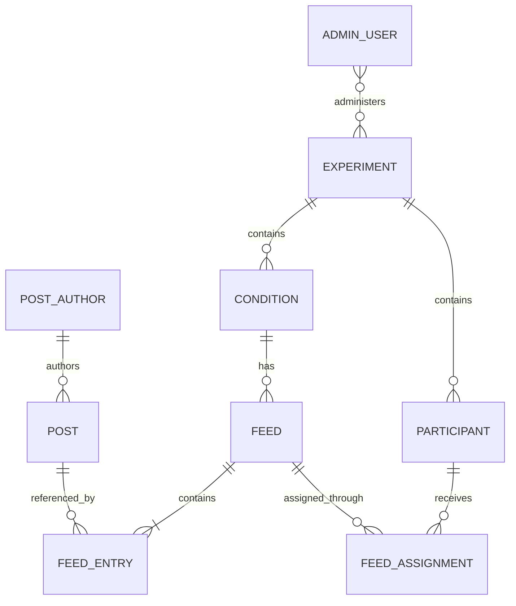

# Domain models

This document defines the concepts used to prepare and run experiments with social media feeds. It describes the intended product behavior and does not prescribe a database schema.

## People and experiments

**Admin user** is a person who signs in to administer experiments. One admin user can administer multiple experiments, and an experiment can have multiple admin users. Access to an experiment is represented separately from the admin user. An admin user is distinct from a participant and from a post author.

**Experiment** groups the participants, conditions, and feeds for a study. Its descriptive information, such as its name, can change.

**Condition** is a named configuration within one experiment. It describes an experimental condition and can cover more than the feed shown. An experiment can have multiple conditions, and a condition can have many prepared feeds. Its descriptive information can change.

**Participant** is someone taking part in one experiment. Their record belongs to that experiment, even if the same person participates in another experiment. Each participant has an application-wide unique ID; an additional study-provided identifier can be scoped to the experiment. A participant can exist before receiving a feed. A lightweight study-provided link is intended for login, but the login mechanism is outside this proposal.

## Content and feeds

**Post author** is the identity displayed as the author of a post. An author can appear on multiple posts. Authors are part of a general content pool and are independent of experiments.

**Post** is a piece of social media content that can appear in a feed. Each post has a stable identifier and one displayed author. Posts form a general pool, and the same post can appear in multiple feeds and experiments. How a post is loaded and represented is managed separately from the feed.

A post can be removed from display even if a saved feed references it. The interface skips the unavailable post and records a skipped-post event. Existing events retain the post's identifier. Whether removal deletes the stored content or marks it unavailable remains open.

**Feed** is a prepared, ordered list of stable post identifiers. It represents the sequence intended for presentation, not a record of what a participant actually saw. A feed belongs to exactly one experiment and one condition in that experiment. An experiment may have many feeds for each condition, and feeds can be prepared before participants exist.

A feed must contain at least one post, and each post identifier can appear only once in the feed. Once saved, a feed cannot be changed. A change in contents or order requires a new feed. Each feed has its own identity, even if its contents match another feed. A feed does not snapshot post content or presentation, and post versioning is out of scope.

**Feed assignment** connects a participant to a prepared feed after login. For now, a participant receives one feed and one condition for their participation. A feed can be assigned to multiple participants. The assigned feed must belong to the participant's experiment and chosen condition; the condition can be determined from the feed. Participants do not select a different feed or condition themselves in the initial scope.

The experiment determines how a condition and eligible feed are selected, but the selection method remains open. If no eligible feed is available, the participant stays unassigned and the failure is reported or recorded. An assignment remains fixed during participation. If reassignment is needed later, preserve the original assignment and create another so past events retain their context.

## Events and engagement

**Event** is a record of something that happened. The same model covers participant actions, presentation events, administrative actions, and system events. Each event has an ID, a defined event type, the time the system received it, and an actor type. It can include an actor identifier; a system actor needs no person identifier. Event-specific information is held in a `record`. The required details are defined for each event type.

Initial event types include a post appearing in the viewport, like, unlike, and skipping an unavailable post. Other supported actions can have their own types. Loading a post, displaying it in the viewport, and acting on it are distinct occurrences. Viewport appearance is the starting definition of exposure; the exact threshold remains open.

A participant event can occur before feed assignment, such as at login. An event about a displayed feed or post identifies the relevant assignment. A post-related event also identifies the post; a skipped-post event retains the unavailable post's ID and the assignment. Events unrelated to a post need no post reference.

Events are append-only during ordinary use. Each action, including a repeated action or an undo, is a separate event. A retry of the same submission is the same occurrence, so it should be retained once. An exceptional correction or deletion policy remains open.

**Engagement metric** is a measure derived from events, rather than an individual action or a stored model in this scope. Metrics can later be calculated across different dimensions. For example, counting like actions and counting currently liked posts are different calculations because likes can be undone. Metric definitions and storage are outside this proposal.

## Relationships

A feed also belongs to the experiment containing its condition. Feed entries express order and reference post identifiers; a reference can remain after a post becomes unavailable. Events refer to the relevant actors and context as described above. The diagram permits historical assignments, while the initial product gives a participant one feed for their participation.
