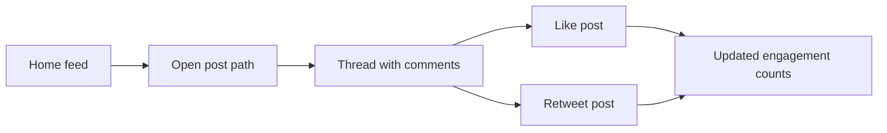

# Build a local feed, post page, and like or retweet loop

## Remember
- Exact file paths always
- Exact commands with expected output
- DRY, YAGNI, TDD, frequent commits
- Delegated tasks must be impossible to misread.

## Overview

Build a local mock social media app that follows one user path. The visitor opens a home feed, opens one post by its own URL, reads the comments on that post, then likes and retweets that post. The backend is a FastAPI app that uses Pydantic models and a dummy dataset stored in a Python file. The UI is a Next.js App Router app that calls that API. The plan covers local UI and backend only. Deploy to Railway or Vercel comes later.

Source requirements live in `strategy_planning/init_plan.md`.

## Happy flow

The visitor lands on the home feed, opens one post by its unique path, reads the comments in that thread, then likes and retweets that post. The engagement counts update from the backend response.

## Approach

Freeze the API shapes and dummy data first, before any real behavior. Write failing tests for the FastAPI read and write paths, then make those tests pass. Scaffold the Next.js UI against that fixed API, then build the feed page and the post page so they look and act like Twitter for this single user path. Finish by taking screenshots of each key screen for review.

## Steps

### Step 1: Freeze API contracts and dummy dataset

Define the Pydantic response shapes, the route list, and the static Python seed data for posts and comments. Do not add runtime HTTP behavior beyond types and seed values.

### Step 2: Scaffold the FastAPI app

Create the FastAPI package layout, entrypoint, routers, and stub handlers that import the contracts and seed data. Imports must resolve. Handlers stay unimplemented.

### Step 3: Test first for feed and post thread reads

Write failing tests for the home feed and single post thread endpoints, then implement only those read paths against the dummy store.

### Step 4: Test first for like and retweet

Write failing tests for like and retweet, then implement those writes so engagement counts update and return on the post payload.

### Step 5: Scaffold the Next.js UI against the local API

Create the frontend App Router project, env wiring for the local backend base URL, and thin page shells for the feed and post routes with no polished UI yet.

### Step 6: Implement the home feed page

Build the Twitter style home feed that loads posts from the backend and links each row to its post path. Capture before and after screenshots for this page.

### Step 7: Implement the post thread and engagement controls

Build the post detail page with the post body, the comment list, and like and retweet controls that call the backend and refresh counts. Capture before and after screenshots for this page.

### Step 8: Capture key journey screenshots and local smoke proof

Run the backend and frontend locally, walk the full happy path, and store journey screenshots under this plan's `images/after/` directory with a short verification checklist result.

## What "done" looks like

1. A local FastAPI server serves feed, post thread, like, and retweet from dummy data.
2. A local Next.js app renders a Twitter style feed and post thread for the single user journey.
3. Clicking a feed item opens a unique post path with comments.
4. Like and retweet update engagement counts from the API response.
5. Backend tests for the journey endpoints pass under `uv run pytest`.
6. Journey screenshots exist under `docs/plans/2026-08-09_local-ui-backend-build_335b55/images/after/` for feed, post thread, like, and retweet.
7. Railway or Vercel production deploy is not required for this plan.
