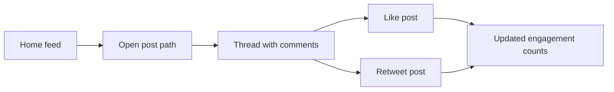

# Build a local Twitter-like feed, post thread, and engagement loop

## Remember
- Exact file paths always
- Exact commands with expected output
- DRY, YAGNI, TDD, frequent commits
- Delegated tasks must be impossible to misread.

## Overview

Ship a local mock social media product that mirrors the core Twitter single-user journey: open a feed, open a post URL, read the thread, then like and retweet. The backend is a FastAPI service with Pydantic models and a Python dummy dataset. The UI is a Next.js App Router app that calls that API. This plan covers local UI + backend only; hosted Railway and Vercel deploy come later.

Source requirements: `strategy_planning/init_plan.md`.

## Happy flow

A visitor lands on the home feed, opens one post by its unique path, reads nested comments in that thread, then likes and retweets that post. Engagement counts update from the backend response.

## Approach

Caller-first and contract-first. Freeze the API and dummy data shape before behavior. Implement the FastAPI read and mutation paths with failing tests first. Scaffold the Next.js UI against that frozen contract, then build feed and thread surfaces to look and behave like Twitter for this single-user path. Finish by capturing screenshots of every key journey for review.

## Steps

### Step 1: Freeze API contracts and dummy dataset

Lock the Pydantic response shapes, route list, and the static Python seed data that hydrates posts and comments. No runtime behavior yet beyond types and seed literals.

### Step 2: Scaffold the FastAPI app

Create the FastAPI package layout, entrypoint, routers, and stub handlers that import the contracts and seed data. Imports must resolve; handlers stay unimplemented.

### Step 3: Test-first implement feed and post-thread reads

Write failing tests for the home feed and single-post thread endpoints, then implement only those read paths against the dummy store.

### Step 4: Test-first implement like and retweet mutations

Write failing tests for like and retweet, then implement those mutations so engagement metrics update and return on the post payload.

### Step 5: Scaffold the Next.js UI against the local API

Create the frontend App Router project, env wiring for the local backend base URL, and thin page shells for the feed and post routes with no polished UI yet.

### Step 6: Implement the home feed page

Build the Twitter-like home feed that loads hydrated posts from the backend and links each row to its post path. Capture before/after screenshots for this surface.

### Step 7: Implement the post thread and engagement controls

Build the post detail page: post body, comment thread, and like/retweet controls that call the backend and refresh counts. Capture before/after screenshots for this surface.

### Step 8: Capture key-journey screenshots and local smoke proof

Run backend and frontend locally, walk the full happy path, and store journey screenshots under this plan’s `images/after/` directory with a short verification checklist result.

## What "done" looks like

1. Local FastAPI server serves feed, post thread, like, and retweet from dummy data.
2. Local Next.js app renders a Twitter-like feed and post thread for the single-user journey.
3. Clicking a feed item opens a unique post path with comments.
4. Like and retweet update engagement metrics from the API response.
5. Backend tests for the journey endpoints are green under `uv run pytest`.
6. Journey screenshots exist under `docs/plans/2026-08-09_local-ui-backend-build_335b55/images/after/` covering feed, post thread, like, and retweet.
7. No Railway or Vercel production deploy is required for this plan.
