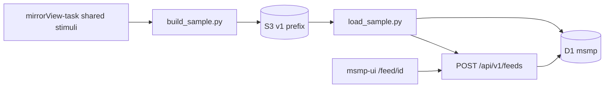
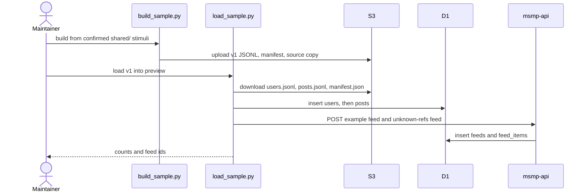

# Proposal: sample feed from MirrorView Study 2 stimuli

Scope: [issue 5](https://github.com/METResearchGroup/mock_social_media_platform/issues/5). This proposal covers the Study 2 sample dataset, where that copy lives, the post schema, the S3 layout, and how one example feed reads it. It does not cover agent simulation, auth, or a Bluesky Iceberg sample. Those stay in the companion issue and in the open choices on issue 5.

## Overview

The hosted feed still serves the 3 users and 9 posts from `cloudflare/api/migrations/0001_init.sql`, so most cards are placeholders. This work copies the MirrorView Study 2 stimuli into S3 as separate original and mirror posts, loads that copy into D1, and creates the example feed through `POST /api/v1/feeds`.

I could not read [METResearchGroup/mirrorView-task](https://github.com/METResearchGroup/mirrorView-task). `gh api repos/METResearchGroup/mirrorView-task` and `git ls-remote` both return 404 with the credentials on this machine, and a fine-grained token is rejected by the organization. The file paths, columns, row counts, and S3 keys of the Study 2 stimuli are unmeasured. The folder and schema below are the plan for after those files are opened.

## Cross-cutting concerns

### What I could and could not read

The Study 2 stimuli are supposed to come from `shared/` in mirrorView-task, through that repo's loader. I do not have a listing of that directory, so I cannot name the file, the schema, or the row count, and I cannot confirm from the files themselves that a given path is the Study 2 set.

Two public notes show the repo exists and how later MirrorView experiments store data. They are not a substitute for reading `shared/`.

- [study_participant_assignment_interface issue 17](https://github.com/METResearchGroup/study_participant_assignment_interface/issues/17) links to mirrorView-task and says feed conversion and the combined post catalog live there. It names assignment buckets `jspsych-mirror-view-3`, `jspsych-mirror-view-4`, and `jspsych-mirror-view-2026-09-09`, with keys under `precomputed_assignments/<timestamp>/`. Those buckets hold assignment batches, not the `shared/` stimuli.
- The proposal examples checked into this repo name these mirrorView-task files. I have not verified them against the repo HEAD.
  - `shared/data/dataloader.py`, function `_use_lab_credentials_when_unset`, for lab AWS credentials.
  - Dataset registration through `shared.data.dataloader`, for example `STUDY_PHASE_2_PART_1_RESULTS_PILOT` pointing at `shared/data/raw/study_phase_2_part_1/results/pilot.csv`. That path is a pilot results export of free-response text. Step 1 still has to find the post stimuli under `shared/`.
  - Study 2 label sets `STUDY_2_KEEP_REMOVE_LABELS`, `STUDY_2_KEEP_REMOVE_UNANIMOUS_LABELS`, and `STUDY_2_KEEP_REMOVE_SPLIT_LABELS`, prepared under `experiments/zero_shot_llm_inference_2026_09_30/` as `inputs/study_2_five_labeler/`. That folder is a labeled subset for keep/remove scoring. Decision 6 asks whether Study 2 showed that subset or the `shared/` stimuli.
  - S3 bucket `mirrorview-experimental-artifacts` and prefix `experiments/<experiment_name>/`.
  - Import rule: root `shared/` never imports from `experiments/`. Experiment-specific constants stay in the experiment folder.

The first implementation step is to open `shared/` and write the real paths, columns, and counts into this proposal before any copy is uploaded.

### Data

Each source row becomes two posts. The original text is `<source_post_id>:original`. The mirror text is `<source_post_id>:mirror`. The two posts do not share an id, and the mirror is not stored as a field on the original.

The archive is JSONL on S3. Git holds Python and Markdown only. Post text stays out of the commit, because the stimuli can include harmful political speech and issue 5 keeps the repo fallback small.

The demo without AWS stays the existing seed: `cloudflare/api/migrations/0001_init.sql` and `src/mock_social_media_platform/data/seed.py`. If S3 cannot be read, the loader stops and leaves that seed in place.

### Storage and keys

Region is `us-east-2`, which is the region in `shared/aws/constants.py` `DEFAULT_REGION_NAME` in [mind_technology_lab_experiments](https://github.com/METResearchGroup/mind_technology_lab_experiments) and in `backend/lib/aws/secretsmanager.py` `get_secret` in the public [mirrorview](https://github.com/METResearchGroup/mirrorview) repo.

The bucket and prefix follow the MirrorView experiment convention above:

```text
s3://mirrorview-experimental-artifacts/experiments/mirrorview_study2_sample_feed_2026_10_27/
```

Keys are a `SecretRef` (secret id, JSON field, region) resolved by `load_env_vars`. The function reads Secrets Manager, sets process environment variables, and never prints values. I did not find a class named `SecretRef` in the files I could open. The name comes from this task. The behavior matches `get_secret` in public `backend/lib/aws/secretsmanager.py` and `load_secret_field` in `shared/aws/secretsmanager.py` in mind_technology_lab_experiments. AWS access keys follow `_use_lab_credentials_when_unset` once that function can be read, with the same rule that values are never printed.

D1 `msmp` is the serving copy. The Worker does not read S3. The loader is the only reader of the sample prefix, which matches the preference in issue 5.

### Feed API

`POST /api/v1/feeds` accepts 1 to 500 post ids (`MAX_POSTS` in `cloudflare/api/src/feeds.ts`). `GET /xrpc/app.bsky.feed.getFeedSkeleton` returns `{ "feed": [{ "post": "<post_ref>" }] }`. That object shape matches `[{"post": feed_dict["item"]}]` in `feed_api/helper.py` in [bluesky-research](https://github.com/METResearchGroup/bluesky-research). Here `post` is the variant id, for example `abc123:original`. `feed_items.post_ref` already stores any string (`cloudflare/api/migrations/0002_feeds.sql`).

Hydrated posts use `PostJson` in `cloudflare/api/src/posts.ts`: `id`, `author` (`id`, `handle`, `display_name`), `text`, `created_at`, `engagement` (`like_count`, `retweet_count`, `reply_count`), `parent_post_id`. The local FastAPI model is `Post` in `src/mock_social_media_platform/models.py`, with the same fields.

### Reuse

| Piece | Where | Role |
| --- | --- | --- |
| D1 `users`, `posts` | `0001_init.sql` | Serving tables. No new columns. |
| D1 `feeds`, `feed_items` | `0002_feeds.sql` | Example feed, created through the API. |
| `toPost` | `cloudflare/api/src/posts.ts` | Hydration for known ids. |
| `handleGetFeedSkeleton` | `cloudflare/api/src/feeds.ts` | Returns `post_ref` values in order. |
| Seed users and posts | `0001_init.sql`, `data/seed.py` | Unchanged no-AWS demo. |

Root `shared/` never imports from `experiments/`. The experiment imports the loader and passes its own bucket and prefix.

## File structure

### Repository

```text
shared/mirrorview_study2/
  __init__.py
  constants.py          region, SecretRef names, Study 2 dataset id once confirmed
  secrets.py            SecretRef and load_env_vars
  dataloader.py         read the confirmed shared/ stimuli; do not import experiments
  storage.py            JSONL and manifest read/write for S3

experiments/mirrorview_study2_sample_feed_2026_10_27/
  README.md             how to rebuild and reseed, source path, counts
  constants.py          bucket, prefix, feed names, author fallback
  build_sample.py       stimuli rows to users.jsonl, posts.jsonl, manifest.json, then upload
  load_sample.py        download the prefix, insert into D1, POST the feeds

docs/plans/2026-10-27_mirrorview-study2-sample-feed_7b2e91/
  proposal.md           this file
```

`frontend/src/components/feed/FeedPostRow.tsx` and `frontend/src/app/page.tsx` should pass post ids through `encodeURIComponent` when linking to `/post/<id>`, so the colon in `<source_post_id>:original` round-trips through `decodePathPart` in `cloudflare/api/src/http.ts`.

Unchanged: `0001_init.sql`, `0002_feeds.sql`, `data/seed.py`, and the Worker route list. No `0003` migration. The dataset version lives in `manifest.json`.

### S3

```text
s3://mirrorview-experimental-artifacts/experiments/mirrorview_study2_sample_feed_2026_10_27/v1/
  manifest.json
  users.jsonl
  posts.jsonl
  feeds/example.json
  feeds/unknown_refs.json
  source/
    <relative path under mirrorView-task shared/, copied after the path is confirmed>
```

`manifest.json` records `study`, `source_repo`, `source_paths`, `source_s3_uris` when the loader reports them, `schema_version`, `built_at`, sha256 of each JSONL file, and row counts. `source/` is the byte copy of the stimuli files. `posts.jsonl` is the two-variant serving copy.

The Study 2 CSV stays on S3. Local development without AWS keeps using the 9 seed posts.

## Schema and key interfaces

| Model | Lives in | Role |
| --- | --- | --- |
| `Study2VariantPost` | `shared/mirrorview_study2/dataloader.py` (new) | One original or one mirror, ready for D1 and the feed API. |
| `SampleManifest` | `shared/mirrorview_study2/storage.py` (new) | Counts, hashes, source paths. Stored in S3. |
| `SecretRef` | `shared/mirrorview_study2/secrets.py` (new) | Secret id, JSON field, region. Not a secret value. |
| `PostJson` | `cloudflare/api/src/posts.ts` (existing) | What the UI renders for a known id. |
| Feed skeleton item | `cloudflare/api/src/feeds.ts` (existing) | `{ "post": "<id>" }`. |

`Study2VariantPost` fields:

| Field | Stored | Maps to |
| --- | --- | --- |
| `id` | S3 and D1 `posts.id` | `<source_post_id>:original` or `<source_post_id>:mirror` |
| `source_post_id` | S3 only | The id column in the Study 2 stimuli, name confirmed in step 1 |
| `variant` | S3 only | `original` or `mirror` |
| `study` | S3 only | `mirrorview_study_2` |
| `text` | S3 and D1 `posts.text` | Original text or mirror text. Not copied into this proposal. |
| `author_id` | S3 and D1 `posts.author_id` | See decision 3 |
| `created_at` | S3 and D1 `posts.created_at` | Source timestamp if present, otherwise one fixed UTC timestamp for the build |
| `like_count`, `retweet_count`, `reply_count` | S3 and D1 | Source counts if present, otherwise `0` |
| `parent_post_id` | S3 and D1 | `null` unless step 1 finds reply links |
| `source_uri` | S3 only | `at://` URI when the stimuli have one, otherwise `null` |

`users.jsonl` matches D1 `users`: `id`, `handle`, `display_name`.

The example feed body is `{ "name": "MirrorView Study 2 sample", "posts": ["<id>:original", "<id>:mirror", ...] }` with at most 500 ids. Order is source order, original then mirror, so a pair stays adjacent. `getFeedSkeleton` returns those ids in that order. The unknown-refs feed uses the first 10 of those ids plus 3 ids that are not in D1, which is goal 2 of issue 5.

A full catalog larger than 500 posts stays in S3. Only the example feed is truncated. See decision 4.

## Steps



### Step 1: Record the Study 2 files

Read `shared/` in mirrorView-task and the loader that Study 2 actually calls. Write the paths, columns, row counts, and any S3 URIs into this proposal. Stop if the files are not the Study 2 set.

### Step 2: Add the loader and secret helper

Add `shared/mirrorview_study2/` with path constants, `SecretRef`, and a dataloader that returns one row per source stimulus. The experiment folder holds the bucket, prefix, and feed names.

### Step 3: Build the two-variant copy and upload it

`build_sample.py` reads the confirmed stimuli, writes `users.jsonl`, `posts.jsonl`, and `manifest.json`, copies the source files under `source/`, and uploads the `v1/` prefix. Row counts in the manifest must match the JSONL line counts. The upload does not print secrets or post text.

### Step 4: Load D1 and create the feeds

`load_sample.py` inserts users, then posts. A second run updates the same ids and does not duplicate them. It then calls `POST /api/v1/feeds` for the example feed and the unknown-refs feed. Reset is a flag that deletes only ids listed in the manifest.

### Step 5: Smoke-check the example feed

Extend `scripts/cloudflare_smoke.py`. After load, `GET /api/v1/feeds/<id>` returns `status: "known"` for every example-feed id, and `getFeedSkeleton` returns the same ids in the same order. The unknown-refs feed returns `status: "unknown"` for the 3 foreign ids. Open `/feed/<id>` on the hosted UI. No unit tests.



## Expected results

A successful build uploads one `v1/` prefix whose `posts.jsonl` has two lines per source stimulus. The source row count is not measured yet, so the post count is `2 * N` once step 1 records `N`. The example feed contains `min(2 * N, 500)` known posts. The 500 cap is measured from `MAX_POSTS` in `cloudflare/api/src/feeds.ts`. The unknown-refs feed contains 10 known ids and 3 unknown ids when `2 * N` is at least 10. User count depends on decision 3. I do not have a runtime or a dollar cost, because the copy is a file transform and the source size is unknown.

## Decisions to confirm

1. **Grant read access to mirrorView-task, or paste the Study 2 `shared/` paths.** I cannot name the stimuli files or their counts until that happens. Recommendation: grant access and rerun step 1 before any upload. The alternative is for Mark to name the loader symbol, the path, and the S3 URI in a reply.
2. **Use `s3://mirrorview-experimental-artifacts/experiments/mirrorview_study2_sample_feed_2026_10_27/v1/`.** Recommendation: that bucket is the one named for MirrorView experiment artifacts, and the prefix matches `experiments/<experiment_name>/`. The alternative in issue 5 is `s3://<lab-bucket>/mock_social_media_platform/sample/v1/`.
3. **Use one author, `user_mirrorview_study_2`, handle `study2`, display name `MirrorView Study 2`, unless the stimuli have author ids.** Recommendation: one author, because the feed requires `posts.author_id` and the study stimuli are post pairs. The alternative is to map source author ids and pseudonymize handles, which issue 5 asks about for a Bluesky sample.
4. **Keep the example feed at 500 posts, original then mirror, in source order.** Recommendation: stay inside `MAX_POSTS` and leave the full JSONL on S3. The alternative is to raise `MAX_POSTS` so one feed can hold every variant.
5. **Leave traceability columns out of D1.** `source_post_id`, `variant`, `study`, and `source_uri` stay in `posts.jsonl`. The variant is already in `posts.id`. Recommendation: no migration. The alternative is a `datasets` table and extra post columns, which issue 5 listed as optional.
6. **Confirm that the `shared/` stimuli, not `inputs/study_2_five_labeler/`, are the posts Study 2 showed.** Recommendation: copy the file the study loader reads, then split each row into original and mirror. The five-labeler input is a later scoring subset.
