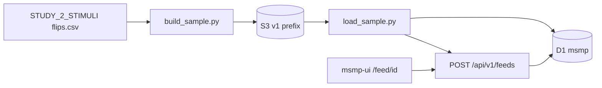
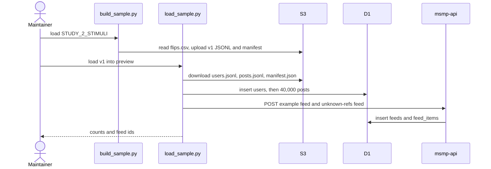

# Proposal: sample feed from MirrorView Study 2 stimuli

Scope: [issue 5](https://github.com/METResearchGroup/mock_social_media_platform/issues/5). This proposal covers the Study 2 sample dataset, where that copy lives, the post schema, the S3 layout, and how one example feed reads it. It does not cover agent simulation, auth, or a Bluesky Iceberg sample. Those stay in the companion issue and in the open choices on issue 5.

## Overview

The hosted feed still serves the 3 users and 9 posts from `cloudflare/api/migrations/0001_init.sql`, so most cards are placeholders. This work reads the MirrorView Study 2 stimuli, writes one feed post for the original text and one feed post for the mirror text, loads those posts into D1, and creates the example feed through `POST /api/v1/feeds`.

Mark read [METResearchGroup/mirrorView-task](https://github.com/METResearchGroup/mirrorView-task) on `main` on 2026-10-27 and recorded the stimuli registry. This environment still cannot open that repo. The paths and the row count below are from that read. The CSV header still has to be checked at implementation time, because only five columns were confirmed.

## Cross-cutting concerns

### Source stimuli

The Study 2 stimuli are the dataset `STUDY_2_STIMULI` in `shared/data/registry.py`. The repo-relative path, which is also the S3 object key, is `shared/data/raw/study_2/stimuli/flips.csv` in bucket `mirrorview-experimental-artifacts` in `us-east-2`.

`shared/data/raw/study_2/README.md` reports 20,000 unique posts. Where `post_primary_key` overlaps between Part 2 and Part 3, the Part 2 row is kept. Study 2 is that combined set. `study_phase_2_part_2` and `study_phase_2_part_3` each have their own `flips.csv`, and `study_2` is the combination.

`shared/data/transformed/study_2/transform.py` uses these columns:

| Column | Role |
| --- | --- |
| `post_primary_key` | Join key. The prefix before the first `_` is the platform. |
| `original_text` | Text of the `<post_primary_key>:original` post. |
| `mirrored_text` | Text of the `<post_primary_key>:mirror` post. |
| `sampled_stance` | Metadata on both variant posts. |
| `sample_toxicity_type` | Metadata on both variant posts. |

Any column besides those five is unchecked. Implementation reads the header, records the extra names in `manifest.json`, and keeps their values in the JSONL metadata. It does not print cell text.

`shared.data.dataloader.load_dataset(name)` reads the registry entry and downloads the bytes with `lib.aws.s3.S3`. `_use_lab_credentials_when_unset()` copies `LAB_AWS_*` into `AWS_*` when `AWS_*` is empty. Values are never printed.

This repo mirrors that layout. `shared/data/registry.py` holds `DatasetEntry(name, relative_path, kind, study_phase)`. `shared/data/dataloader.py` exposes `load_dataset`. `shared/data/README.md` says git ignores the CSVs and S3 stores each file at the same relative key. `shared/data/raw/study_2/README.md` documents `STUDY_2_STIMULI`. Root `shared/` never imports from `experiments/`.

`kind` and `study_phase` are copied from the mirrorView `STUDY_2_STIMULI` entry when the registry file can be opened. They are not invented here.

### Data

Each of the 20,000 source rows becomes two posts, so the sample has 40,000 posts. The ids are `<post_primary_key>:original` and `<post_primary_key>:mirror`. `original_text` is the text of the original post. `mirrored_text` is the text of the mirror post. The two posts do not share an id.

`sampled_stance`, `sample_toxicity_type`, and `platform` stay on both posts as metadata. `platform` is the `post_primary_key` prefix before the first `_`.

The archive is JSONL on S3. Git holds Python and Markdown only. Post text stays out of the commit, because the stimuli can include harmful political speech and issue 5 keeps the repo fallback small. `.gitignore` ignores `*.csv` under `shared/data/raw/`, matching mirrorView, where the CSV lives on S3 at the relative key and is not committed.

The demo without AWS stays the existing seed in `cloudflare/api/migrations/0001_init.sql` and `src/mock_social_media_platform/data/seed.py`. If S3 cannot be read, the loader stops and leaves that seed in place.

### Storage and keys

The source object is already at `s3://mirrorview-experimental-artifacts/shared/data/raw/study_2/stimuli/flips.csv`. The build reads it and does not upload a second copy of `flips.csv`.

The derived sample uses the same bucket and the experiment prefix:

```text
s3://mirrorview-experimental-artifacts/experiments/mirrorview_study2_sample_feed_2026_10_27/v1/
```

Credentials follow `_use_lab_credentials_when_unset` in the dataloader. The dataloader downloads with a small `S3` reader in `shared/aws/s3.py`, which gets object bytes for a registry `relative_path` the same way mirrorView's `lib.aws.s3.S3` does. The reader does not print keys or body text.

D1 `msmp` is the serving copy of all 40,000 posts. The Worker does not read S3. The loader is the only reader of the sample prefix, which matches the preference in issue 5.

### Feed API

`POST /api/v1/feeds` accepts 1 to 500 post ids (`MAX_POSTS` in `cloudflare/api/src/feeds.ts`). `GET /xrpc/app.bsky.feed.getFeedSkeleton` returns `{ "feed": [{ "post": "<post_ref>" }] }`. That object shape matches `[{"post": feed_dict["item"]}]` in `feed_api/helper.py` in [bluesky-research](https://github.com/METResearchGroup/bluesky-research). Here `post` is the variant id. `feed_items.post_ref` already stores any string (`cloudflare/api/migrations/0002_feeds.sql`).

Hydrated posts use `PostJson` in `cloudflare/api/src/posts.ts`: `id`, `author` (`id`, `handle`, `display_name`), `text`, `created_at`, `engagement` (`like_count`, `retweet_count`, `reply_count`), `parent_post_id`. The local FastAPI model is `Post` in `src/mock_social_media_platform/models.py`, with the same fields. `sampled_stance`, `sample_toxicity_type`, and `platform` stay in the JSONL, because `PostJson` has no fields for them.

### Reuse

| Piece | Where | Role |
| --- | --- | --- |
| `STUDY_2_STIMULI` | mirrorView `shared/data/registry.py` | Source of the 20,000 rows. Read through this repo's registry entry with the same relative path. |
| `load_dataset` | mirrorView `shared/data/dataloader.py` | Pattern for this repo's `shared/data/dataloader.py`. |
| D1 `users`, `posts` | `0001_init.sql` | Serving tables. No new columns. |
| D1 `feeds`, `feed_items` | `0002_feeds.sql` | Example feed, created through the API. |
| `toPost` | `cloudflare/api/src/posts.ts` | Hydration for known ids. |
| `handleGetFeedSkeleton` | `cloudflare/api/src/feeds.ts` | Returns `post_ref` values in order. |
| Seed users and posts | `0001_init.sql`, `data/seed.py` | Unchanged demo when S3 is unavailable. |

## File structure

### Repository

```text
shared/data/
  README.md                 registry, gitignore, S3 key equals relative path
  registry.py               DatasetEntry and STUDY_2_STIMULI
  dataloader.py             load_dataset and _use_lab_credentials_when_unset
  raw/study_2/README.md     20,000 posts, Part 2 kept on key overlap, known columns
shared/aws/
  s3.py                     get object bytes for a relative path

experiments/mirrorview_study2_sample_feed_2026_10_27/
  README.md                 how to rebuild and reseed, source path, counts
  constants.py              bucket, prefix, feed names, author fallback
  build_sample.py           STUDY_2_STIMULI to users.jsonl, posts.jsonl, manifest.json, then upload
  load_sample.py            download the prefix, insert into D1, POST the feeds

docs/plans/2026-10-27_mirrorview-study2-sample-feed_7b2e91/
  proposal.md               this file
```

`frontend/src/components/feed/FeedPostRow.tsx` and `frontend/src/app/page.tsx` should pass post ids through `encodeURIComponent` when linking to `/post/<id>`, so the colon in `<post_primary_key>:original` round-trips through `decodePathPart` in `cloudflare/api/src/http.ts`.

`0001_init.sql`, `0002_feeds.sql`, `data/seed.py`, and the Worker route list stay as they are. There is no `0003` migration, and the dataset version lives in `manifest.json`.

### S3

```text
s3://mirrorview-experimental-artifacts/shared/data/raw/study_2/stimuli/flips.csv
  existing STUDY_2_STIMULI object, 20,000 rows, read only

s3://mirrorview-experimental-artifacts/experiments/mirrorview_study2_sample_feed_2026_10_27/v1/
  manifest.json
  users.jsonl
  posts.jsonl          40,000 lines
  feeds/example.json
  feeds/unknown_refs.json
```

`manifest.json` records `study` as `mirrorview_study_2`, the registry name `STUDY_2_STIMULI`, the source key, `schema_version`, `built_at`, sha256 of each JSONL file, the source row count 20,000, the post count 40,000, the known columns, and any extra header names found at build time.

## Schema and key interfaces

| Model | Lives in | Role |
| --- | --- | --- |
| `DatasetEntry` | `shared/data/registry.py` (new here, same fields as mirrorView) | `name`, `relative_path`, `kind`, `study_phase`. |
| `Study2VariantPost` | `experiments/mirrorview_study2_sample_feed_2026_10_27/build_sample.py` (new) | One original or one mirror, ready for D1 and the feed API. |
| `SampleManifest` | same experiment `build_sample.py` (new) | Counts, hashes, source key, column names. Stored in S3. |
| `PostJson` | `cloudflare/api/src/posts.ts` (existing) | What the UI renders for a known id. |
| Feed skeleton item | `cloudflare/api/src/feeds.ts` (existing) | `{ "post": "<id>" }`. |

`Study2VariantPost` fields:

| Field | Stored | Maps to |
| --- | --- | --- |
| `id` | S3 and D1 `posts.id` | `<post_primary_key>:original` or `<post_primary_key>:mirror` |
| `post_primary_key` | S3 only | Source join key |
| `variant` | S3 only | `original` or `mirror` |
| `study` | S3 only | `mirrorview_study_2` |
| `text` | S3 and D1 `posts.text` | `original_text` or `mirrored_text` |
| `platform` | S3 only | Prefix of `post_primary_key` before the first `_` |
| `sampled_stance` | S3 only | Same value on both variants |
| `sample_toxicity_type` | S3 only | Same value on both variants |
| `author_id` | S3 and D1 `posts.author_id` | See decision 3 |
| `created_at` | S3 and D1 `posts.created_at` | One fixed UTC timestamp for the build, unless the header check finds a timestamp column |
| `like_count`, `retweet_count`, `reply_count` | S3 and D1 | `0`, unless the header check finds count columns |
| `parent_post_id` | S3 and D1 | `null`. The five known columns have no parent link. |

`users.jsonl` matches D1 `users`: `id`, `handle`, `display_name`.

The example feed body is `{ "name": "MirrorView Study 2 sample", "posts": ["<post_primary_key>:original", "<post_primary_key>:mirror", ...] }` with at most 500 ids. Order is source order, original then mirror, so a pair stays adjacent. `getFeedSkeleton` returns those ids in that order. D1 still holds all 40,000 posts. The unknown-refs feed uses the first 10 of those ids plus 3 ids that are not in D1, which is goal 2 of issue 5.

## Steps



### Step 1: Add the registry and dataloader

Add `shared/data/registry.py`, `shared/data/dataloader.py`, `shared/data/README.md`, and `shared/data/raw/study_2/README.md`, plus `shared/aws/s3.py`. `STUDY_2_STIMULI` points at `shared/data/raw/study_2/stimuli/flips.csv`. `load_dataset` downloads that object. The build reads the header, checks that the five known columns are present, and records any other column names. It does not print cell text.

### Step 2: Build the 40,000 posts and upload them

`build_sample.py` loads `STUDY_2_STIMULI`, writes two `Study2VariantPost` rows per source row, writes `users.jsonl`, `posts.jsonl`, and `manifest.json`, and uploads the `v1/` prefix. The manifest post count is 40,000 and the source count is 20,000. The upload does not print secrets or post text.

### Step 3: Load D1 and create the feeds

`load_sample.py` inserts users, then all 40,000 posts. A second run updates the same ids and does not duplicate them. It then calls `POST /api/v1/feeds` for the example feed and the unknown-refs feed. Reset is a flag that deletes only ids listed in the manifest.

### Step 4: Smoke-check the example feed

Extend `scripts/cloudflare_smoke.py`. After load, `GET /api/v1/feeds/<id>` returns `status: "known"` for every example-feed id, and `getFeedSkeleton` returns the same ids in the same order. The unknown-refs feed returns `status: "unknown"` for the 3 foreign ids. Open `/feed/<id>` on the hosted UI. No unit tests.



## Expected results

A successful build uploads one `v1/` prefix whose `posts.jsonl` has 40,000 lines, two per source row. The 20,000 source rows are the count Mark read from `shared/data/raw/study_2/README.md`. This environment has not recounted the CSV. The example feed contains 500 known posts, which is `MAX_POSTS` in `cloudflare/api/src/feeds.ts`. The unknown-refs feed contains 10 known ids and 3 unknown ids. User count depends on decision 3. There is no separate dollar cost for the copy, because it is a file transform of an existing S3 object.

## Decisions to confirm

1. **Confirmed.** The source is `STUDY_2_STIMULI` at `s3://mirrorview-experimental-artifacts/shared/data/raw/study_2/stimuli/flips.csv`, 20,000 posts, 40,000 feed posts, ids `<post_primary_key>:original` and `<post_primary_key>:mirror`. The header beyond `post_primary_key`, `original_text`, `mirrored_text`, `sampled_stance`, and `sample_toxicity_type` is still checked at implementation time.
2. **Write the derived files to `s3://mirrorview-experimental-artifacts/experiments/mirrorview_study2_sample_feed_2026_10_27/v1/`.** The source object already lives in `mirrorview-experimental-artifacts`, so the derived prefix uses that bucket too. The alternative in issue 5 is `s3://<lab-bucket>/mock_social_media_platform/sample/v1/`.
3. **Use one author, `user_mirrorview_study_2`, handle `study2`, display name `MirrorView Study 2`.** The five known columns have no author id. The alternative is to map an author column if the header check finds one.
4. **Keep the example feed at 500 posts, original then mirror, in source order, while D1 holds all 40,000 posts.** The alternative is to raise `MAX_POSTS` so one feed can hold every variant.
5. **Leave `post_primary_key`, `variant`, `study`, `platform`, `sampled_stance`, and `sample_toxicity_type` out of D1.** They stay in `posts.jsonl`. The variant is already in `posts.id`. The alternative is a `datasets` table and extra post columns, which issue 5 listed as optional.
6. **Confirmed.** The posts Study 2 showed are `STUDY_2_STIMULI`, the combined Part 2 and Part 3 set, with the Part 2 row kept when `post_primary_key` overlaps. The sample is that file, split into original and mirror posts.
