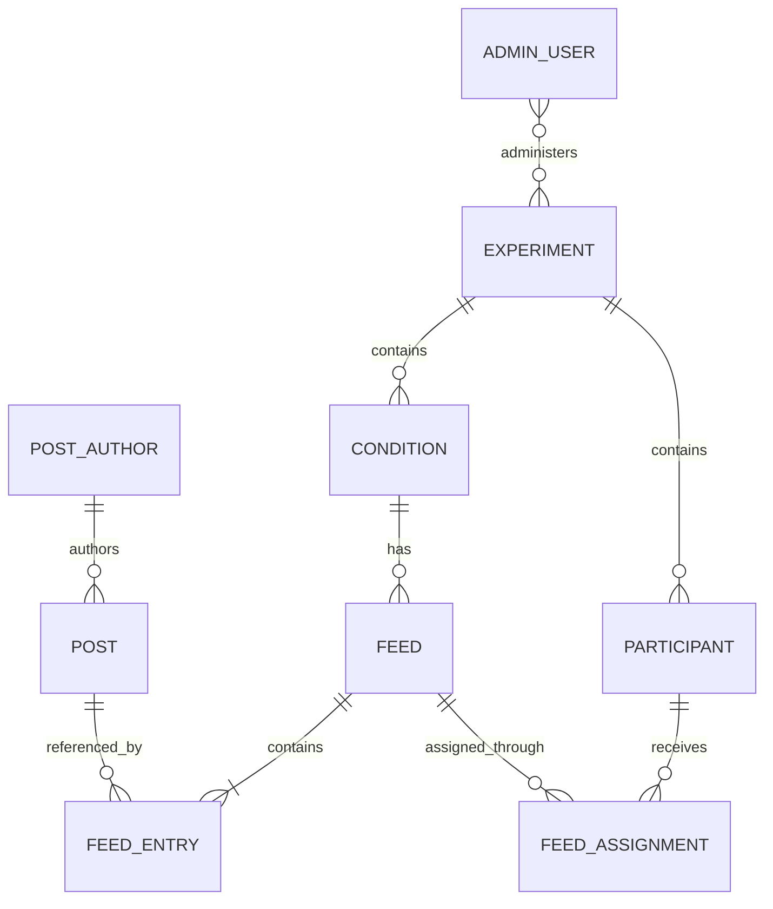

# Domain model decisions

These decisions record the discussion of `2026-11-07-design-notes.md`. They describe the current scope, not a complete implementation design.

1. **Can an administrative user administer multiple experiments, and can an experiment have multiple administrative users?** Yes to both. Access to an experiment is represented separately from the administrative user.
2. **Is a participant shared across experiments?** No. A participant record is specific to one experiment. A cross-experiment person identity is not needed now.
3. **Is experiment an explicit model?** Yes. An experiment groups participants and conditions.
4. **What is a condition?** A named configuration within an experiment. It is separate from a feed and can describe differences beyond the feed.
5. **What should someone who administers experiments be called?** Admin user. This is distinct from a post author.
6. **Can a participant be assigned to multiple conditions in one experiment?** One condition for now.
7. **What is a feed?** A prepared, ordered collection of post identifiers describing the intended presentation. What a participant actually sees is recorded separately. Feeds can be prepared before participants exist; an experiment can have many feeds per condition.
8. **Can a post appear in multiple feeds or experiments?** Yes. Posts have their own identities and feeds reference them.
9. **Are individual actions retained?** Yes. Retain individual events and derive aggregate measures from them.
10. **Does admin user fit, and is each login intended for one person?** Use admin user, with one login identity per person for now.
11. **How many feeds does a participant receive?** One feed for their participation for now, assigned after login.
12. **Can a feed be assigned to multiple participants?** Yes.
13. **Does a feed snapshot post presentation?** No. It contains an ordered list of stable post identifiers. Post loading and representation are managed separately; versioning is out of scope.
14. **What counts as exposure?** Loading, appearing in the viewport, and explicit participant actions are separate event types. Viewport appearance is the starting definition of exposure; its exact threshold remains to be defined.
15. **Are event and activity separate models?** Use one event model with different event types for now. Activity need not be a separate model.
16. **What does a post-related event identify?** The participant, post, event type, time, and feed assignment.
17. **Can actions be repeated or undone?** Yes. Each action, including repeats and undo actions, is a separate event.
18. **What is engagement?** An individual action is an event. An engagement metric is a defined aggregate derived from events.
19. **How does a participant log in?** A lightweight study-provided link in the URL is intended. The login mechanism is out of scope for now; participant identity is separate from admin user identity.
20. **Does an assignment remain fixed?** Yes, for the duration of participation. If reassignment is needed, preserve the original and create a new assignment so events retain their context.
21. **How do condition and feed selection relate?** Assign a participant a feed belonging to the participant's condition and experiment. The condition can be determined through the feed.
22. **Can a post occur more than once in a feed?** No. Post identifiers must be unique within a feed.
23. **Are engagement metrics stored as records now?** No. Define them as calculations over events; persistence can be considered when needed.
24. **Can a participant exist before feed assignment?** Yes. A participant may exist without an assignment.
25. **What does a feed belong to?** Exactly one experiment and one condition within that experiment. These associations are strict and must agree.
26. **Does a post have an author?** Yes. A post references one displayed post author, and an author can appear on multiple posts. Post authors are separate from admin users and participants.
27. **Can events be unrelated to a particular post?** Yes. Feed-level events, such as opening or leaving a feed, need no post reference. Events identify the participant, type, and time; post-related events also identify the post and feed assignment.
28. **Can an event contribute to multiple metrics?** Yes. Metrics specify the relevant event type, grouping, and aggregation rule. A count of like actions is different from a count of currently liked posts because undo events affect the latter.
29. **How broadly unique is a participant ID?** Each participant record has an application-wide unique ID. A study-provided identifier can be scoped to the experiment.
30. **Which event timestamp is needed?** Record when the system received the event. A separate device occurrence timestamp is not needed now.
31. **How are repeated actions recorded?** A repeated action is a separate event. Handling retries of the same submission remains unspecified; a retry is not necessarily a new action.
32. **Do posts belong to an experiment?** No. Posts form a general pool independent of experiments. Feeds are linked to an experiment and condition and reference posts from that pool.
33. **Can a saved feed be updated?** No. Once written to storage, a feed can only be read. Create a new feed to change its contents or order.
34. **How is a feed selected?** The experiment determines the selection method. The model records the resulting assignment; the selection method remains open.
35. **What if no eligible feed is available?** Leave the participant unassigned and report or record the failure. Do not assign a feed from another condition.
36. **When is a condition assigned?** It can be determined at login using a method defined by the experiment. The condition is recoverable through the assigned feed.
37. **What happens when the same action is submitted twice due to a retry?** Retain one event for that occurrence. A deliberate repeated action produces a separate event.
38. **Can events occur before feed assignment?** Yes. For example, a login event can identify the participant without an assignment. Events concerning a displayed feed or post require the relevant assignment.
39. **What happens if a feed references a post that cannot be loaded?** Skip rendering the post without changing the feed. Record a skipped-post event as decided below.
40. **How are engagement metrics scoped?** Metric definitions are out of scope for now. Metrics can be derived after the fact across different dimensions of events.
41. **Are event types fixed or arbitrary?** Start with a defined, extensible set of event types.
42. **Can event types have different details?** Yes. Events have common fields such as `id`, `event_type`, and `created_at`, plus a JSONB `record` for event-specific details.
43. **Do administrative actions use the same event model?** Yes. Use one event model across participant, administrative, and system events.
44. **Can a saved feed be empty?** No. It must contain at least one post.
45. **Can a referenced post be removed?** Yes. A feed remains unchanged; the UI skips the removed post.
46. **How is an event actor identified?** Use an actor type and optional actor identifier. A system actor needs no person identifier.
47. **Is there an event for a skipped post?** Yes. Add an event type for skipping an unavailable post.
48. **Do historical events retain deleted post identifiers?** Yes. Existing events retain the stable identifier even if the post no longer loads.
49. **What are the initial event types?** Start with post appeared in the viewport, like, unlike, and skipped unavailable post, plus other actions supported by the initial interface. Further types remain to be defined.
50. **Does a skipped-post event identify the missing post?** Yes. Record the stable post identifier and feed assignment.
51. **Where do event-specific relationships go?** Keep the actor in common fields and put event-specific references in `record` for now. Define the required contents per event type.
52. **Does post removal mean deleting content or marking it unavailable?** The domain behavior is that it is unavailable for display. The storage mechanism remains open.
53. **Are identical feeds distinct?** Yes. Each saved feed has its own stable ID even if its contents and associations match another feed.
54. **Can recorded events be changed?** Treat events as append-only in ordinary application behavior. Undo actions are new events; exceptional correction or deletion policy remains open.
55. **Can experiment and condition descriptions change?** Yes. Descriptive fields can change, while a feed's experiment and condition associations stay fixed.
56. **Can participants choose another feed or condition?** Not in the initial scope. Their assignment determines what they see.
57. **Are post authors independent of experiments?** Yes. Post authors are part of the general content pool and can be referenced by posts used in any experiment.

## Approved relationship map

A feed also has a strict association with its experiment, which must agree with its condition's experiment. Each feed entry references a unique post identifier within that feed. A participant has one feed assignment for now; historical assignments are retained if reassignment is later necessary. Events use the common model described above and carry relevant references in their event-specific records.
